# Kinetra

Fitness tracking app built with Flutter and Riverpod: log workouts set by set, set goals and watch them move, and read clear progress reports.

## Demo

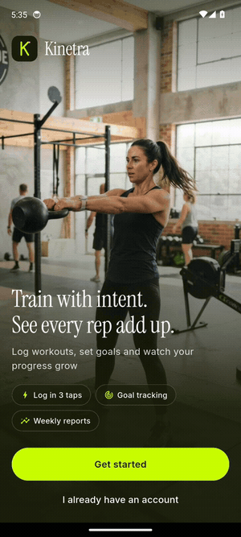

Captured on an Android emulator. The same codebase builds for iOS.

## What it shows

- **Exercise logging**: start a routine, log weight and reps per set with steppers, tick sets done, a rest timer starts on its own (+15 s or skip). Add exercises mid-session from a searchable library filtered by muscle group.
- **Workout summary**: total volume, duration, sets, reps, an estimated calorie count, load per rep compared with the last time, and any new personal record found in the log.
- **Goal tracking**: strength, distance, body weight and consistency goals. A saved workout moves the matching goals (a heavier bench set raises the bench goal, a fourth session completes the weekly target). New goals get a live preview with the weekly pace needed and validation.
- **Progress reports**: weekly volume bar chart (4 weeks, 3 or 6 months), workouts per week and body weight trends, personal records, and a weekly report comparing the last full week with the one before.
- **Today**: weekly activity ring, streak, active minutes, kilograms lifted, today's plan and recent session, plus a first-run empty state.
- 26 weeks of realistic sample history, so every chart and record is computed from data, not drawn by hand.

## Screenshots

| Welcome | Goal setup | Today | Workouts |
|---|---|---|---|
| 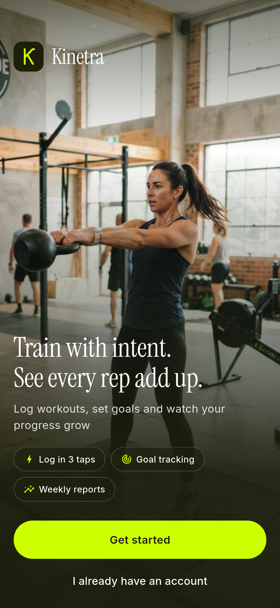 | 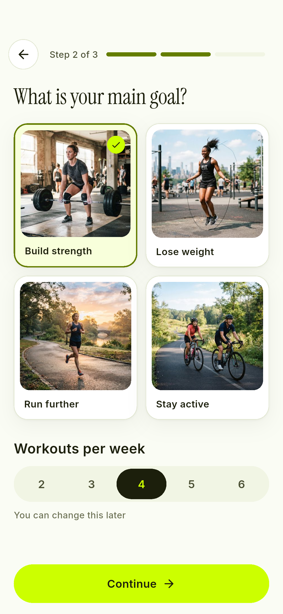 | 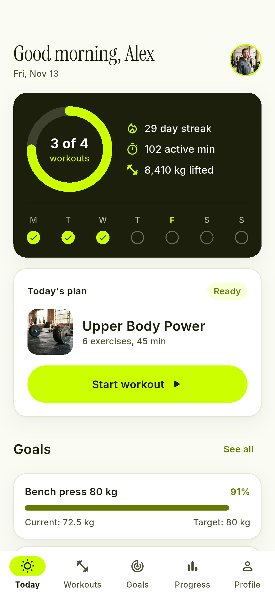 | 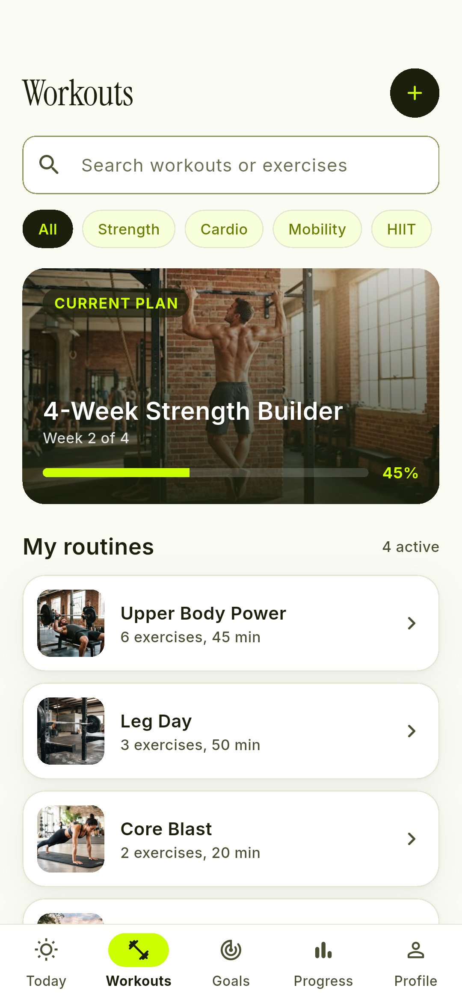 |

| Routine | Live logging | Add exercise | Summary |
|---|---|---|---|
| 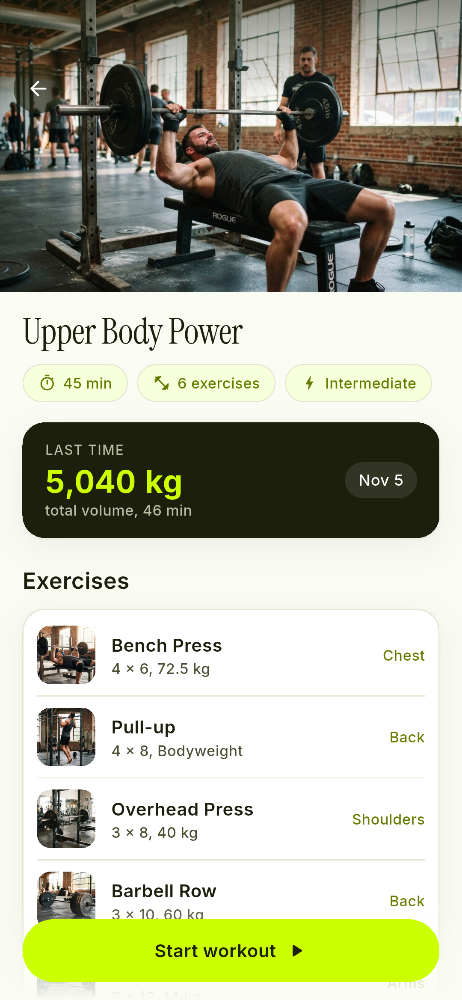 | 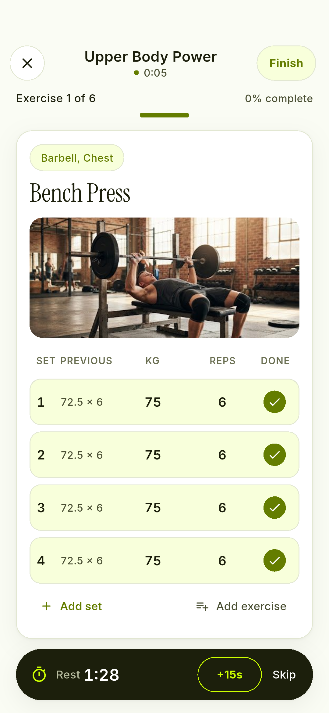 | 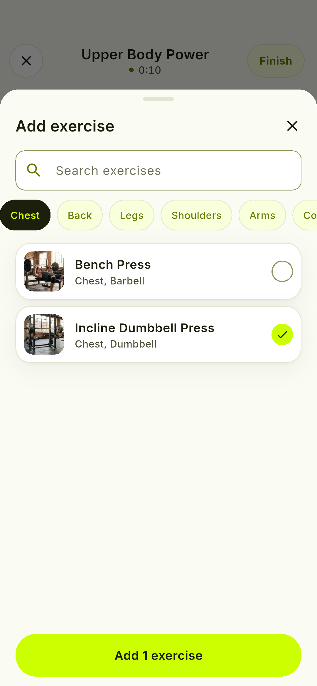 | 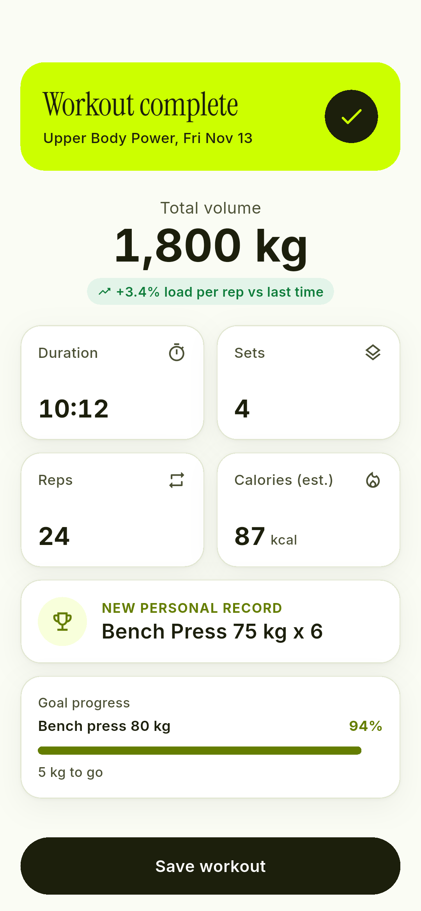 |

| Goals | New goal | Progress | Weekly report |
|---|---|---|---|
| 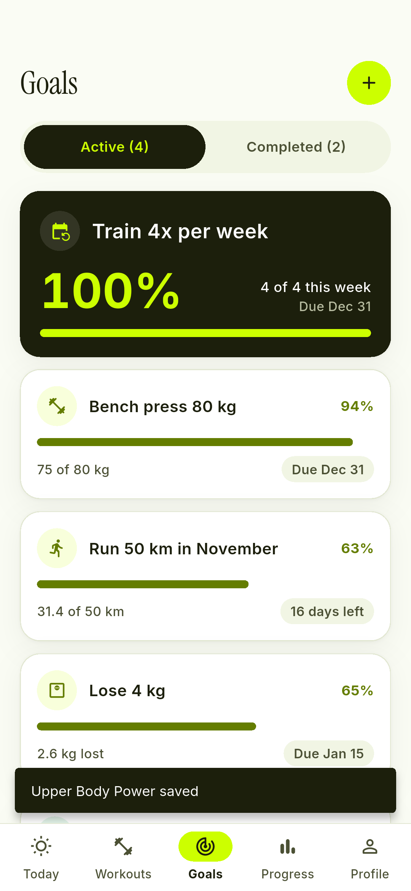 | 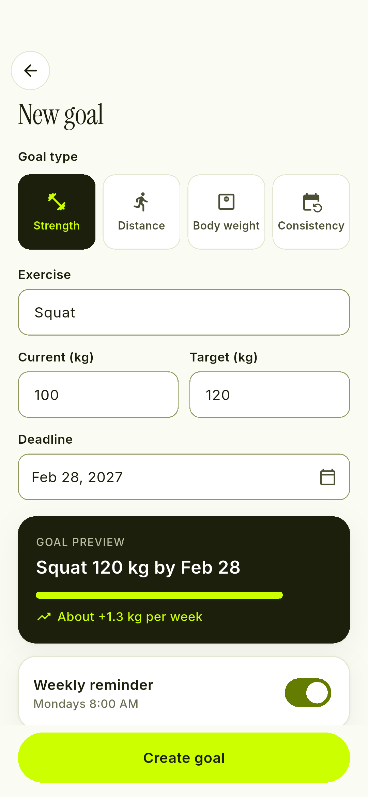 | 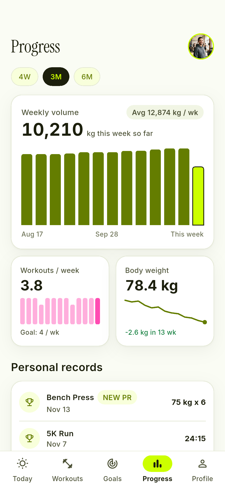 | 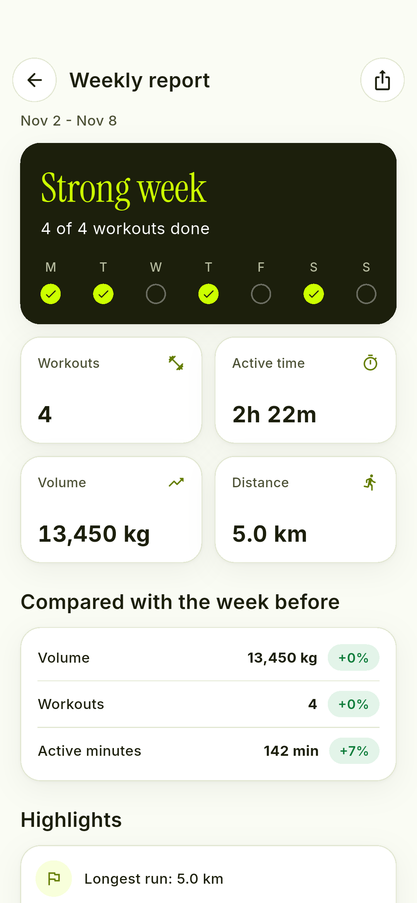 |

| Profile | First run |
|---|---|
| 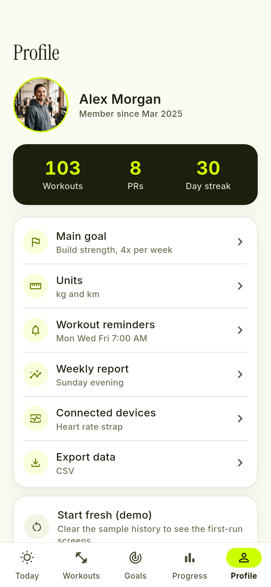 | 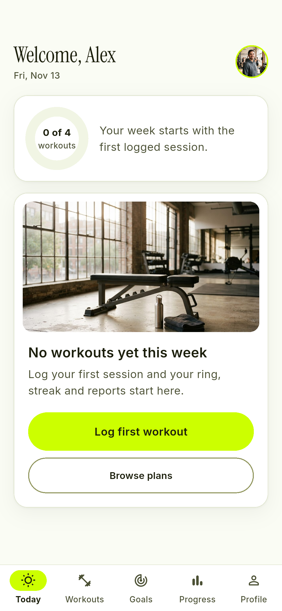 |

## App flow

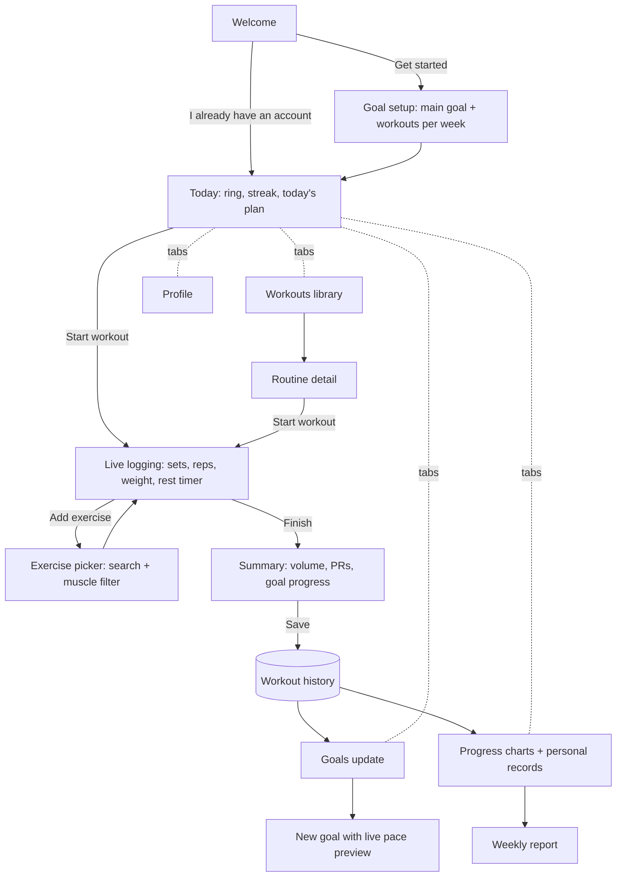

## Architecture

```
lib/
  domain/     models (Exercise, Routine, SetLog, WorkoutSession, Goal) and Stats (pure functions)
  data/       exercise library, routines, 26 weeks of sample history, goals
  state/      Riverpod Notifiers: profile, tab, history, goals, active workout
  core/       design tokens, shared controls, chart painters (ring, bars, sparklines)
  features/   onboarding, today, workouts, goals, progress, profile, shell
```

- **State**: Riverpod 3 `Notifier`s. History is the single source of truth; `statsProvider` derives weekly volume, streaks, records and reports from it, so a saved workout updates Today, Goals and Progress at once.
- **Live workout**: `ActiveWorkoutNotifier` holds the per-exercise set logs; the screen owns only the clock and rest timer.
- **Design**: tokens and screens follow the Google Stitch design in `design/` (Inter + Instrument Serif, neon chartreuse on ink).
- **Tests**: unit tests for the stats and widget tests that walk every key screen at phone size with the real fonts.
- **Simulated**: no backend, sign-in, wearables, GPS or export. Data lives in memory and resets on restart.

## Run

```sh
flutter pub get
flutter run          # Android emulator or iOS simulator
flutter test         # unit + widget tests
```

Flutter 3.35, Dart 3.9.
